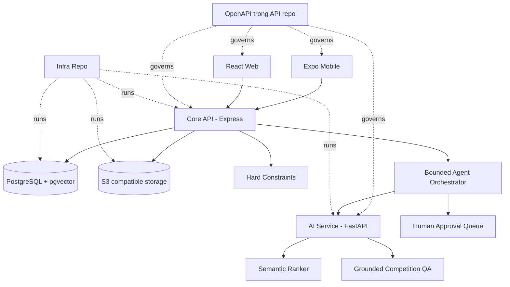

# System Overview

Multition dùng multi-repo với một Core API làm system of record và một AI
service Python riêng. Sơ đồ dưới đây là kiến trúc mục tiêu; codebase hiện tại chỉ
là technical scaffold và chưa triển khai các luồng nghiệp vụ trong sơ đồ.

## Repository boundaries

- `multition-mobile`: trải nghiệm chính cho học sinh/sinh viên.
- `multition-web`: workspace cho organizer, moderator và team leader.
- `multition-api`: Express scaffold, OpenAPI/schema chuẩn, database connection, migration và nơi sẽ chứa nghiệp vụ.
- `multition-ai`: FastAPI scaffold cho ranking, retrieval, RAG và model evaluation sau này.
- `multition-infra`: môi trường local, database, object storage và deployment config.
- `multition-docs`: product definition, ADR, research và assignment artifacts.

Mobile/web không gọi AI trực tiếp. Core API xác thực, giới hạn dữ liệu gửi sang
AI, validate response và lưu audit trail trước khi trả kết quả cho client.

## Local ports

| Service | Port |
|---|---:|
| API | 4000 |
| AI service | 8000 |
| Web | 5173 |
| PostgreSQL | 5432 |
| MinIO API | 9000 |
| MinIO Console | 9001 |
| Expo | do Expo CLI cấp |

## Trạng thái codebase hiện tại

- Mobile và web chỉ có bootstrap screen để xác nhận framework chạy.
- Core API và AI service chỉ có `GET /health`.
- Migration chỉ bật `pgcrypto`, `pgvector` và tạo bảng theo dõi migration.
- Contracts chỉ mô tả health endpoints.
- Chưa có CRUD, authentication, matching, ranking, RAG hoặc agent loop.

Nhóm sẽ triển khai từng vertical slice thông qua Issues và Pull Requests sau khi
chốt UI, database schema và API contract.
