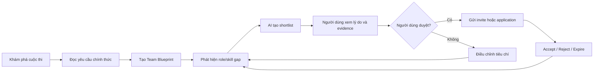
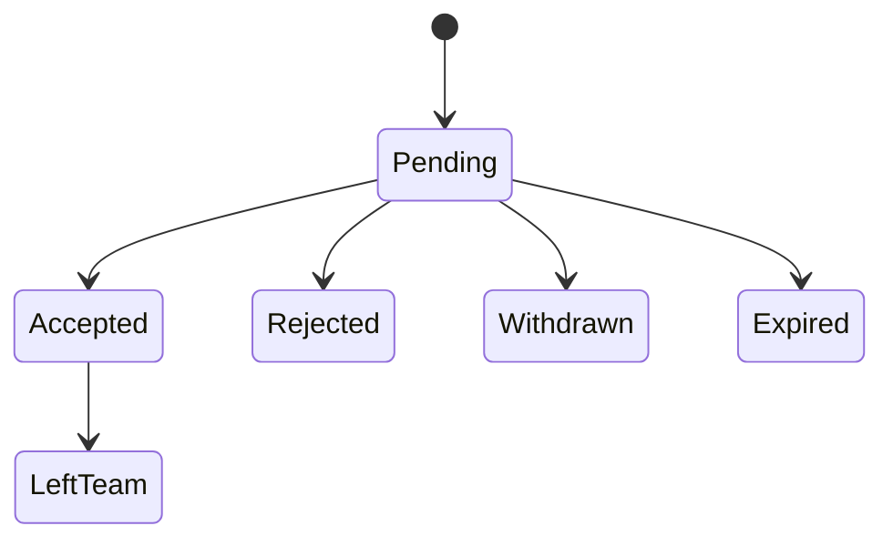
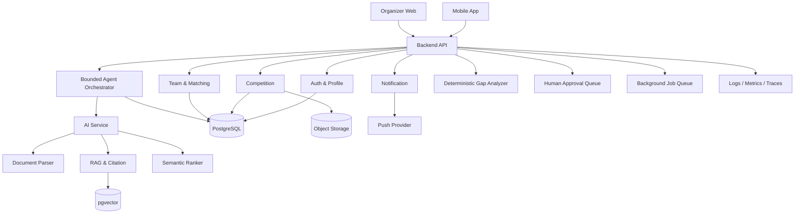

# Bản ý tưởng ban đầu — lưu trữ

> Tài liệu lịch sử, không đại diện cho phạm vi Assignment 1 hiện tại. MVP hiện tại tập trung ghép đội thủ công, chat trực tiếp và chat nhóm; AI/agent/RAG nằm ngoài MVP. Xem báo cáo được liên kết từ README chính để biết phạm vi hiện hành.

# Multition


> **AI Team Formation Copilot for Competitions**
>
> Biến yêu cầu của một cuộc thi thành một đội hình phù hợp.

Multition là nền tảng mobile-first giúp học sinh và sinh viên tìm cuộc thi, xây dựng hồ sơ năng lực có bằng chứng và kết nối với những đồng đội phù hợp. Thay vì chỉ đăng bài “đội đang thiếu người”, Multition phân tích yêu cầu cuộc thi, trạng thái hiện tại của đội và hồ sơ ứng viên để phát hiện khoảng trống kỹ năng, đề xuất shortlist và giải thích lý do phù hợp.

**Nhóm thực hiện:** Multition · L02

**Loại dự án:** Mobile Development Assignment

**Trạng thái:** Foundation scaffold / Pre-MVP

---

## 1. Bài toán

Học sinh và sinh viên thường tìm đồng đội qua Facebook, Zalo, Discord hoặc các mối quan hệ cá nhân. Quy trình này phân tán và thiếu dữ liệu có cấu trúc để trả lời những câu hỏi quan trọng:

- Người này có đúng kỹ năng mà đội đang thiếu không?
- Kinh nghiệm và thành tích được chứng minh bằng gì?
- Hai bên có cùng mục tiêu và mức độ cam kết không?
- Lịch rảnh, địa điểm và hình thức tham gia có tương thích không?
- Đội còn thiếu vai trò nào trước deadline đăng ký?

Vấn đề cốt lõi không phải là thiếu cộng đồng, mà là **thiếu tín hiệu đáng tin cậy để quyết định có nên lập đội với một người chưa quen**.

## 2. Người dùng mục tiêu

### Người tìm đội

Học sinh, sinh viên muốn tìm cuộc thi hoặc gia nhập một đội phù hợp với kỹ năng, lịch rảnh, địa điểm và mục tiêu của mình.

### Trưởng nhóm / người tuyển thành viên

Người đã có ý tưởng hoặc một phần đội hình nhưng cần tìm thêm thành viên cho những vai trò cụ thể trước deadline.

### Ban tổ chức cuộc thi

Đơn vị đăng tải và xác minh thông tin cuộc thi, tài liệu chính thức, mốc thời gian và điều kiện tham gia. Đây là nhóm người dùng mở rộng, không phải điều kiện bắt buộc để kiểm chứng MVP đầu tiên.

## 3. Giá trị khác biệt

Multition không phải mạng xã hội sinh viên tổng quát và cũng không chỉ là một hệ thống CRUD hồ sơ.

| Cách tìm đội hiện tại | Multition |
|---|---|
| Bài đăng tự do, khó so sánh | Team Blueprint mô tả rõ vai trò và kỹ năng còn thiếu |
| Hồ sơ chỉ là lời tự khai | Evidence-backed profile gắn CV, GitHub, portfolio và thành tích |
| Tìm kiếm thủ công trong nhiều group | AI chủ động tạo shortlist dựa trên gap của đội |
| Khó biết vì sao một người phù hợp | Giải thích match dựa trên dữ liệu và bằng chứng cụ thể |
| Dễ bỏ lỡ lời mời và deadline | Push notification và deadline tracking trên mobile |

**Định vị ngắn gọn:**

> Multition giúp học sinh, sinh viên xây dựng đúng đội hình cho cuộc thi bằng hồ sơ có bằng chứng và một AI agent liên tục phát hiện, giải thích và đề xuất cách lấp đầy khoảng trống của đội.

## 4. Luồng sản phẩm cốt lõi



Một vòng sử dụng điển hình:

1. Người dùng chọn hoặc tạo một cuộc thi.
2. Tài liệu chính thức được tải lên hoặc liên kết với cuộc thi.
3. AI trích xuất điều kiện, deadline, quy mô đội và kỹ năng liên quan; mỗi dữ kiện quan trọng phải có nguồn trích dẫn.
4. Trưởng nhóm xác nhận Team Blueprint: đội hiện có ai, còn thiếu vai trò nào, yêu cầu bắt buộc và ưu tiên.
5. Agent lọc và xếp hạng ứng viên trong hệ thống.
6. Người dùng xem mức độ phù hợp, bằng chứng và những điểm chưa chắc chắn.
7. Chỉ sau khi người dùng xác nhận, hệ thống mới gửi lời mời.
8. Khi thành viên từ chối, rời đội, thay đổi availability hoặc deadline đến gần, agent chạy lại với trạng thái mới.

## 5. Tính năng AI trung tâm: Team Formation Agent

### 5.1 Vì sao đây không chỉ là chatbot?

Chatbot chỉ phản hồi khi được hỏi. Team Formation Agent làm việc theo một vòng lặp có mục tiêu, trạng thái và điều kiện dừng rõ ràng:

```text
Observe
  -> Detect gap or opportunity
  -> Retrieve candidates/teams
  -> Apply hard constraints
  -> Rank and explain
  -> Ask for human approval
  -> Observe feedback
  -> Update state and run again when necessary
```

Agent không chỉ sinh văn bản. Nó phối hợp nhiều công cụ nội bộ để đọc dữ liệu cuộc thi, truy vấn hồ sơ, kiểm tra điều kiện, xếp hạng và tạo hành động chờ duyệt.

### 5.2 Competition Intelligence

Từ tài liệu chính thức của ban tổ chức, hệ thống hỗ trợ:

- Trích xuất deadline, đối tượng tham gia, số lượng thành viên, deliverables và tiêu chí chấm.
- Chuẩn hóa kỹ năng hoặc vai trò có liên quan.
- Tạo bản nháp Team Blueprint để người dùng xác nhận.
- Trả lời câu hỏi bằng RAG với trích dẫn theo tài liệu/trang/đoạn.
- Trả lời **“Không tìm thấy trong tài liệu chính thức”** nếu không có đủ căn cứ.
- Hiển thị phiên bản và ngày cập nhật tài liệu để tránh dùng quy định cũ.

RAG ở đây là một công cụ của quy trình lập đội, không phải một chatbot đứng riêng bên cạnh sản phẩm.

### 5.3 Gap Analysis

Agent so sánh yêu cầu của cuộc thi với đội hình hiện tại để tạo danh sách khoảng trống:

- Vai trò còn thiếu.
- Kỹ năng bắt buộc chưa được bao phủ.
- Xung đột availability hoặc hình thức tham gia.
- Đội chưa đủ hoặc vượt quá số lượng thành viên.
- Evidence còn yếu ở một năng lực quan trọng.
- Rủi ro do deadline đến gần nhưng lời mời chưa được phản hồi.

### 5.4 Candidate Retrieval & Ranking

Quy trình đề xuất ứng viên gồm hai lớp:

1. **Hard constraints bằng code:** eligibility, deadline, team size, trạng thái hồ sơ, online/offline, địa điểm, lịch rảnh và việc tham gia trùng đội.
2. **AI-assisted ranking:** mức độ phủ skill gap, độ mạnh của evidence, kinh nghiệm liên quan, mục tiêu và mức độ cam kết.

Công thức baseline dự kiến:

```text
match_score =
    35% skill_gap_coverage
  + 25% availability_fit
  + 20% evidence_strength
  + 10% goal_commitment_fit
  + 10% location_mode_fit
```

Các trọng số trên là **giả thuyết ban đầu**, không phải chân lý. Nhóm sẽ điều chỉnh chúng bằng dữ liệu phỏng vấn, hành vi invite/accept và đánh giá shortlist của người dùng thật.

Mỗi đề xuất cần trả lời ba phần:

- **Why fit:** bằng chứng nào cho thấy ứng viên phù hợp?
- **Possible gaps:** điều gì còn thiếu hoặc chưa được xác minh?
- **Constraint check:** eligibility, availability và location đã đạt hay chưa?

### 5.5 Hai chế độ agent

| Team-side agent | Seeker-side agent |
|---|---|
| Theo dõi Team Blueprint | Theo dõi hồ sơ và mong muốn của người tìm đội |
| Phát hiện role/skill gap | Tìm cuộc thi và đội đang thiếu đúng vai trò |
| Đề xuất 3–5 ứng viên phù hợp | Đề xuất cơ hội phù hợp và giải thích lý do |
| Chuẩn bị invite chờ trưởng nhóm duyệt | Chuẩn bị application chờ người dùng duyệt |
| Chạy lại khi đội hình hoặc deadline thay đổi | Chạy lại khi profile hoặc preference thay đổi |

### 5.6 Human-in-the-loop

Agent **được phép** tự động:

- Đọc dữ liệu đã được cấp quyền.
- Phát hiện gap và rủi ro.
- Tìm kiếm, lọc, xếp hạng và giải thích.
- Tạo shortlist hoặc bản nháp hành động.
- Gửi thông báo về đề xuất mới hay deadline.

Agent **không được phép** tự động:

- Gửi application hoặc invite thay người dùng.
- Thêm người vào đội hoặc loại thành viên khỏi đội.
- Công khai CV, tài liệu hoặc thông tin liên hệ riêng tư.
- Tự xác nhận thành tích chưa được kiểm chứng.
- Loại ứng viên chỉ dựa trên kết luận của mô hình AI.

Mọi hành động ảnh hưởng đến con người đều phải có bước xác nhận rõ ràng.

## 6. Phạm vi MVP

### 6.1 P0 — Bắt buộc

- Đăng ký, đăng nhập và phân quyền cơ bản.
- Hồ sơ kỹ năng, availability, mức độ cam kết và preference.
- Evidence profile: CV, GitHub, portfolio, chứng chỉ và thành tích cuộc thi.
- Competition feed và bộ lọc theo lĩnh vực, hình thức tham gia, địa điểm và deadline.
- Tạo cuộc thi và quản lý tài liệu chính thức.
- Tạo Team Blueprint và bài đăng tuyển thành viên.
- Apply / Invite với state machine rõ ràng.
- Push notification cho lời mời, phản hồi và deadline.
- AI Competition Intelligence + Gap Analysis + Candidate Shortlist.
- Giải thích đề xuất và yêu cầu người dùng duyệt trước khi gửi.
- Privacy controls, report/block và audit log cơ bản.
- Production logging, error monitoring và AI trace.

### 6.2 P1 — Nếu còn thời gian

- Q&A trên tài liệu cuộc thi bằng RAG có citation.
- Team Readiness dashboard.
- Feedback cho recommendation: phù hợp, không phù hợp, sai availability, thiếu evidence.
- Organizer-verified competition và evidence verification theo mức độ.
- Reminder thông minh khi deadline đến gần.

### 6.3 Ngoài phạm vi học kỳ

- Quảng cáo và marketplace khóa học.
- Thanh toán hoặc subscription.
- Mạng xã hội/newsfeed tổng quát.
- Chat realtime hoàn chỉnh bằng Socket.IO.
- Tự động thu thập dữ liệu hàng loạt từ website bên ngoài.
- AI tự gửi lời mời hoặc tự quyết định thành viên.

Sau khi match, đội có thể tiếp tục trao đổi qua Zalo, Discord hoặc công cụ sẵn có. Realtime chat chỉ nên được xây khi nghiên cứu người dùng chứng minh rằng giao tiếp trong Multition là một vấn đề cốt lõi.

## 7. Vai trò và use case chính

| Vai trò | Use case |
|---|---|
| Student | Tạo profile, thêm evidence, tìm cuộc thi, tìm đội, apply, nhận đề xuất |
| Team leader | Tạo đội, khai báo gap, xem shortlist, gửi invite, quản lý thành viên |
| Organizer | Tạo/xác minh cuộc thi, cập nhật tài liệu và deadline |
| Moderator/Admin | Xử lý report, nội dung sai lệch và tài khoản vi phạm |
| AI agent | Trích xuất yêu cầu, phát hiện gap, tạo shortlist và giải thích |

## 8. Mô hình trạng thái quan trọng

### Application / Invitation



### Trạng thái xác minh evidence

- `SELF_DECLARED`: do người dùng tự khai.
- `LINKED_SOURCE`: có liên kết nguồn như GitHub hoặc portfolio.
- `PEER_CONFIRMED`: được teammate cũ xác nhận.
- `ORGANIZER_VERIFIED`: được ban tổ chức hoặc nguồn chính thức xác minh.
- `DISPUTED`: đang có báo cáo hoặc cần kiểm tra lại.

Multition không đồng nhất “đã upload” với “đã xác minh”. Trạng thái nguồn phải được hiển thị trực tiếp trong giao diện.

## 9. Mô hình dữ liệu mức cao

Các thực thể dự kiến:

- `User`, `StudentProfile`, `Skill`, `UserSkill`
- `Evidence`, `Achievement`, `PortfolioLink`, `Availability`
- `Competition`, `CompetitionDocument`, `CompetitionRequirement`
- `CompetitionRound`, `Venue`, `Province`, `CompetitionProvince`
- `Team`, `TeamMember`, `TeamBlueprint`, `TeamNeed`
- `Application`, `Invitation`, `Notification`
- `RecommendationRun`, `Recommendation`, `RecommendationFeedback`
- `DocumentChunk`, `Citation`, `AgentAction`, `AuditLog`

Địa điểm không được lưu bằng một chuỗi tỉnh/thành duy nhất. Competition cần tách riêng:

- Eligibility scope: toàn quốc hoặc một số khu vực.
- Participation mode: `ONLINE`, `OFFLINE`, `HYBRID`.
- Venue và địa điểm theo từng vòng.
- Yêu cầu di chuyển và hỗ trợ chi phí, nếu có.

Danh mục đơn vị hành chính nên được cấu hình hoặc đồng bộ từ nguồn dữ liệu chính thức, không hard-code số lượng tỉnh/thành vào logic nghiệp vụ.

## 10. Kiến trúc mục tiêu

Multition dùng **Core API modular monolith** cho nghiệp vụ và một **bounded AI
service** riêng cho model workloads. Mobile/web chỉ gọi Core API; AI không có
quyền tự thay đổi business state.



Core API sở hữu authorization, CRUD, hard constraints và approval. AI service
chỉ trả suggestion/citation theo contract và phải có deterministic fallback.

## 11. Công nghệ đã chốt cho foundation

| Thành phần | Đề xuất |
|---|---|
| Mobile | React Native + Expo + TypeScript |
| Web quản trị/BTC | React + Vite + TypeScript |
| Backend | Node.js + Express + TypeScript |
| Database | PostgreSQL + pgvector |
| File storage | S3-compatible object storage |
| Background jobs | Redis + BullMQ hoặc queue tương đương |
| AI service | Python 3.12 + FastAPI + Pydantic; capability AI chưa triển khai |
| API contract | OpenAPI; sinh typed client cho mobile/web |
| Push notification | Expo Notifications hoặc Firebase Cloud Messaging |
| Observability | Structured logs + error tracking + metrics/traces |
| Deployment | Docker + CI/CD theo từng ứng dụng |

## 12. Tổ chức repository

Cấu trúc gồm sáu repository tại [GitHub Organization Multition](https://github.com/Multition):

```text
multition-mobile    # Ứng dụng React Native / Expo
multition-web       # Web cho organizer và admin
multition-api       # Core API scaffold, OpenAPI và generated types
multition-ai        # FastAPI scaffold cho capability AI trong tương lai
multition-infra     # Compose, storage, deployment foundation
multition-docs      # Product docs, ADR, research và báo cáo môn học
```

Để clone và chạy bộ khung, xem [Developer onboarding](../development/onboarding.md).
OpenAPI được quản lý tại `multition-api/openapi/`; chạy `npm run contracts:sync`
tại API repo để đồng bộ type sang mobile/web. Các tính năng trong tài liệu này
là kế hoạch sản phẩm, chưa được triển khai trong scaffold.

Không tách thêm repository cho từng domain CRUD hoặc từng model. Một AI service
là đủ; các capability ranking/RAG nằm trong cùng service và chỉ tách tiếp khi có
bằng chứng rõ về scale, security hoặc ownership.

Repository tài liệu chứa product definition, ADR và tài sản thương hiệu:

```text
.
├── README.md
├── architecture/
├── adr/
└── assets/
    ├── multition-logo.png
    └── multition-logo.svg
```

## 13. API behavior mẫu cho AI recommendation

Ví dụ response từ một recommendation run:

```json
{
  "teamId": "team_123",
  "missingRole": "UI/UX Designer",
  "runReason": "MEMBER_REJECTED_INVITE",
  "candidates": [
    {
      "userId": "user_456",
      "score": 0.86,
      "hardConstraintsPassed": true,
      "reasons": [
        "Portfolio có 2 case study mobile app",
        "Có thể tham gia 8 giờ/tuần trong thời gian cuộc thi",
        "Ưu tiên cuộc thi Product Design và hình thức online"
      ],
      "gaps": [
        "Chưa có evidence được organizer xác minh"
      ],
      "evidenceIds": ["evidence_10", "evidence_11"]
    }
  ],
  "proposedAction": "CREATE_INVITE_DRAFT",
  "requiresHumanApproval": true
}
```

LLM output phải được validate bằng schema. Các rule bắt buộc như eligibility, deadline, team size và quyền riêng tư không được giao hoàn toàn cho mô hình.

## 14. Đánh giá AI

Một feature AI chỉ được xem là có giá trị khi đo lường được, không phải vì câu trả lời nghe thuyết phục.

### Competition Intelligence

- Độ chính xác khi trích xuất deadline, eligibility và team size.
- Citation correctness: nội dung trả lời có thật sự được nguồn hỗ trợ không?
- Tỷ lệ người dùng phải sửa Team Blueprint do AI tạo.
- Tỷ lệ câu hỏi được từ chối đúng khi tài liệu không chứa câu trả lời.

### Recommendation

- Precision@K hoặc tỷ lệ ứng viên phù hợp trong top 3–5.
- Tỷ lệ shortlist được trưởng nhóm lưu hoặc chọn.
- Invite acceptance rate.
- Thời gian từ lúc tạo Team Blueprint đến khi có shortlist hữu ích.
- Tỷ lệ đội hoàn thiện đủ thành viên trước deadline.
- Tỷ lệ đề xuất bị bỏ qua và lý do bị từ chối.

### Agent reliability

- Tỷ lệ tool call thành công.
- Tỷ lệ output vượt qua schema validation.
- Số vòng lặp trung bình trước khi dừng.
- Latency, token usage và chi phí cho mỗi recommendation run.
- Tỷ lệ hành động nhạy cảm bị chặn đúng trước bước human approval.

## 15. Production logging & monitoring

Để đáp ứng yêu cầu vận hành production, hệ thống cần tối thiểu:

- JSON structured logs với `request_id`, `user_id` đã mask/hash, `module`, `event` và `latency_ms`.
- Error tracking cho mobile, web, API và background jobs.
- Metrics: request rate, error rate, p95 latency, queue depth và push delivery rate.
- AI trace: model/version, prompt template version, retrieved document IDs, citation IDs, tool calls, schema validation và token usage.
- Audit log cho thay đổi competition, invite/application và thao tác của admin.
- Alert cho API error spike, job thất bại liên tục, queue backlog và chi phí AI bất thường.
- Dashboard tách product metrics khỏi system metrics.

Không ghi raw CV, access token, nội dung tin nhắn riêng tư hoặc tài liệu nhạy cảm vào log. Log cần có retention policy và quyền truy cập phù hợp.

## 16. Quyền riêng tư và an toàn

- Người dùng kiểm soát ai được xem CV, portfolio và thông tin liên hệ.
- Chỉ index cho AI những tài liệu mà người dùng đã cấp quyền.
- File upload cần kiểm tra định dạng, kích thước và malware.
- Mọi recommendation phải chỉ ra nguồn evidence được sử dụng.
- Cho phép người dùng report, block và yêu cầu xóa dữ liệu.
- Không dùng giới tính, dân tộc, tôn giáo hoặc thuộc tính nhạy cảm để xếp hạng.
- Không xem điểm AI là phán quyết về năng lực con người.

## 17. Giả định rủi ro nhất và kế hoạch kiểm chứng

**Giả định:** Evidence có cấu trúc kết hợp với giải thích của AI sẽ khiến người dùng đủ tin tưởng để mời một người chưa quen vào đội.

Nếu giả định này sai, Multition có thể trở thành một danh sách hồ sơ đẹp nhưng không tạo ra hành vi ghép đội thực tế.

### Thử nghiệm đề xuất

1. Phỏng vấn 15–20 học sinh/sinh viên từng tham gia cuộc thi.
2. Cho họ thực hiện cùng một nhiệm vụ với hai loại profile:
   - Profile cơ bản chỉ có mô tả kỹ năng.
   - Profile có evidence, availability và lời giải thích match.
3. Ghi nhận ai họ muốn mời, lý do, mức độ tin tưởng và thông tin còn thiếu.
4. Pilot flow với khoảng 5 đội cho các cuộc thi thật.

### Tiêu chí quyết định

- **Giữ hướng:** phần lớn người tham gia sẵn sàng gửi invite và evidence/availability xuất hiện rõ trong lý do quyết định.
- **Điều chỉnh:** chỉ một vài loại evidence có giá trị; thu hẹp schema và thuật toán theo các tín hiệu đó.
- **Đổi hướng:** evidence và giải thích không thay đổi quyết định, hoặc người dùng chỉ muốn lập đội với người đã quen.

Các con số trên là mục tiêu kiểm chứng, **không phải kết quả đã đạt được**.

## 18. Roadmap dự kiến

### Phase 0 — Validate

- Phỏng vấn người dùng và kiểm tra trust signals.
- Chốt user journey, schema evidence và Team Blueprint.
- Prototype recommendation explanation.

### Phase 1 — Core product

- Auth, profile, competition, team, apply/invite và notification.
- Baseline deterministic matching.
- Deploy môi trường staging và thiết lập monitoring.

### Phase 2 — AI copilot

- Document extraction có citation.
- Gap analysis và candidate retrieval.
- Explainable shortlist + human approval.
- Offline evaluation bằng bộ test cố định.

### Phase 3 — Production pilot

- Chạy thử với người dùng thật.
- Theo dõi product/system/AI metrics.
- Điều chỉnh ranking từ feedback thực tế.

## 19. Nguyên tắc phát triển

- Bắt đầu từ một vấn đề cụ thể, không xây “super app”.
- Rule nghiệp vụ quan trọng phải deterministic và test được.
- AI hỗ trợ quyết định, không thay thế trách nhiệm của người dùng.
- Không tuyên bố evidence đã xác minh nếu chỉ mới được upload.
- Không tuyên bố RAG “loại bỏ hallucination”; hệ thống chỉ giảm rủi ro bằng nguồn, citation và refusal.
- Mỗi feature mới phải gắn với một giả định hoặc metric rõ ràng.
- Ưu tiên một vertical slice chạy được trên production hơn nhiều màn hình CRUD rời rạc.

## 20. License

Dự án được xây dựng cho mục đích học tập trong môn Mobile Development. Quyền sử dụng mã nguồn và tài sản thiết kế sẽ được nhóm Multition thống nhất trước khi phát hành công khai.

---

**Multition — Build the right team, not just a bigger network.**
